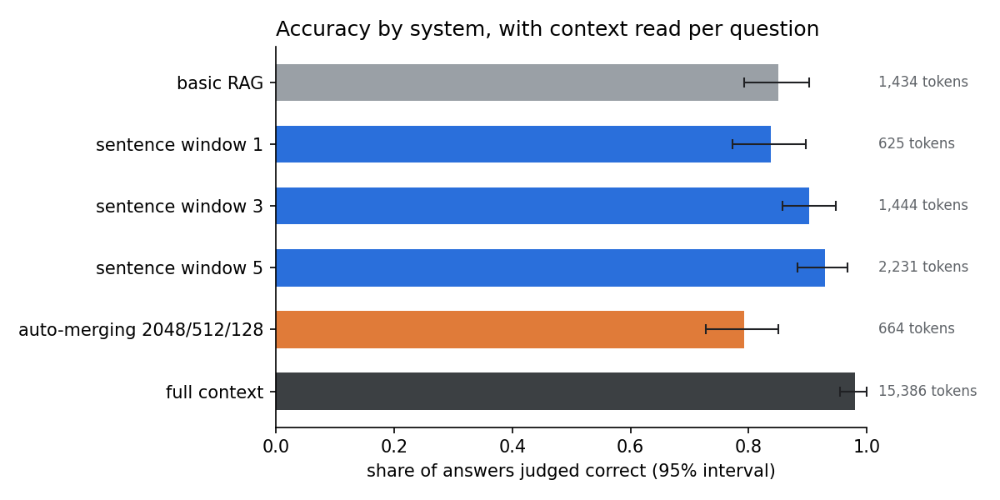

# Sentence window vs. auto-merging: benchmarking LlamaIndex RAG on a document with exact ground truth


Which LlamaIndex retrieval method answers questions about a document more accurately, and where does each one
fail? This project compares **sentence-window** and **auto-merging** retrieval against basic RAG and a
full-context reference, using a purpose-built benchmark where the correct answer, and the exact sentence that
supports it, is known for every question.



## Key findings

1. **Sentence window beats auto-merging, and the difference is real.** At LlamaIndex's default settings,
   sentence window (3) answered 90% correctly vs. 79% for auto-merging. Compared question by question, the
   difference is −0.11 (95% interval −0.18 to −0.05), which excludes zero. Larger windows helped: 84% → 90% → 93%
   for windows of 1, 3 and 5 sentences.
2. **Retrieval is the bottleneck, not the model.** Wrong answers were mostly *retrieval failures* (the evidence
   never reached the model, 8–22% of answers). *Generation failures*, where the evidence was there but the answer
   was still wrong, were 0–2% for every system.
3. **Summaries are where RAG breaks.** Every RAG system scored 0.42–0.67 on section summaries vs. 0.92 for full
   context: six retrieved snippets cannot summarise a section. Basic RAG also fell for superseded figures (0.17).
4. **The model refuses rather than hallucinates.** No system answered an unanswerable question, and no answer
   contained an invented figure. The real error is over-caution. RAG systems refused 9–24% of answerable
   questions (full context: 1%).
5. **Full context is the ceiling, but costs 7× more tokens.** It scored 0.98 vs. 0.93 for the best RAG system
   (`sentence window 5`), reading ~15,400 tokens per question instead of ~2,200. With prompt caching that gap
   mostly disappears for one small document; for large or many documents, retrieval is the only option.
6. **The full RAG triad is expensive.** It took 117–127 min per system vs. 18–27 min with only correctness and
   groundedness.

## Results

Final run: `154` questions per system, Ollama 0.40.7. `n` = answers the judge scored.

| System | Correct (95% interval) | Grounded | Evidence found | Tokens / question | Seconds / question |
|---|---|---|---|---|---|
| Basic RAG (256-token chunks) | 0.85 (0.79–0.90) | 0.93 | 0.72 | 1,434 | 3.8 |
| Sentence window 1 | 0.84 (0.78–0.90) | 0.90 | 0.77 | 625 | 2.0 |
| Sentence window 3 | 0.90 (0.86–0.94) | 0.94 | 0.84 | 1,444 | 3.2 |
| **Sentence window 5** | **0.93** (0.88–0.97) | 0.94 | 0.88 | 2,231 | 4.0 |
| Auto-merging 2048/512/128 | 0.79 (0.73–0.86) | 0.90 | 0.69 | 664 | 2.2 |
| Full context (reference) | 0.98 (0.95–1.00) | n/a | 1.00 | 15,386 | 3.1 |

All correctness and groundedness scores have n = 154.

**RAG triad** (head-to-head pair only):

| System | Answer relevance | Context relevance |
|---|---|---|
| Sentence window 3 | 0.97 (n = 154) | 0.85 (n = 153) |
| Auto-merging 2048/512/128 | 0.96 (n = 154) | 0.76 (n = 154) |

**Share correct by question type:**

| Type | Basic RAG | SW 1 | SW 3 | SW 5 | Auto-merging | Full context |
|---|---|---|---|---|---|---|
| Single fact | 0.90 | 0.92 | 0.96 | 0.98 | 0.87 | 1.00 |
| Table lookup | 0.75 | 0.56 | 0.81 | 0.88 | 0.62 | 1.00 |
| Near-duplicate trap | 0.94 | 0.89 | 1.00 | 1.00 | 0.89 | 0.94 |
| Multi-step, same section | 0.85 | 0.90 | 1.00 | 1.00 | 0.90 | 1.00 |
| Cross-section | 0.95 | 0.95 | 0.95 | 0.95 | 0.80 | 1.00 |
| Summary | 0.67 | 0.50 | 0.42 | 0.58 | 0.42 | 0.92 |
| Superseded figure | 0.17 | 0.50 | 0.67 | 0.67 | 0.33 | 0.83 |
| Unanswerable | 1.00 | 1.00 | 1.00 | 1.00 | 1.00 | 1.00 |

**Hallucination checks** (no LLM):

| System | Answers unanswerable anyway | Refuses answerable questions | Not grounded (judge) |
|---|---|---|---|
| Basic RAG | 0.00 | 0.19 | 0.07 |
| Sentence window 1 | 0.00 | 0.20 | 0.10 |
| Sentence window 3 | 0.00 | 0.10 | 0.06 |
| Sentence window 5 | 0.00 | 0.09 | 0.06 |
| Auto-merging | 0.00 | 0.24 | 0.10 |
| Full context | 0.00 | 0.01 | n/a |

The number check flagged one answer per system ("83 ports"), a false positive: the report writes "Eighty-three".

**Cost:** $0 on a free Kaggle GPU. With a mid-tier API model (~$2 per million input tokens), answering a million
questions would cost about $4,900 with sentence window 5 vs. $31,200 with full context, before prompt caching.


## How it is measured

| Measure | How | Judge? |
|---|---|---|
| **Evidence found** | Share of evidence sentences present, word for word, in the text the model read | No |
| **Correct** | LlamaIndex `CorrectnessEvaluator`: grade 1–5 against the reference answer; 4 or more counts as correct | LLM |
| **Grounded** | LlamaIndex `FaithfulnessEvaluator`: is the answer supported by the retrieved text? (a proxy for hallucination) | LLM |
| **Answer / context relevance** | The other two legs of the RAG triad, on the head-to-head pair only | LLM |
| **Retrieval vs. generation failure** | Wrong answer with evidence missing vs. present | No |
| **Hallucination checks** | Answering unanswerable questions, refusing answerable ones, numbers that appear nowhere in the report | No |

All systems use the same answering model (`qwen3.5:9b`), embedding model (`nomic-embed-text`), prompt and
`top_k = 6`, all running locally through Ollama. Intervals are 95% bootstrap intervals over questions; the
head-to-head uses a paired bootstrap on per-question differences. Every judge score reports `n`, the number of
answers it was based on.

## Reproducibility

- **Run to run (same platform):** two Kaggle runs two days apart gave identical evidence found and context size
  for every system (retrieval is deterministic), and correctness within 0.03 per system.
- **Machine to machine:** `test_retest_colab.ipynb` loads the exported best system on a Colab GPU, re-judges the
  Kaggle answers (judge consistency, Cohen's κ) and answers all 154 questions again (system consistency).
- Each run records its GPU, Ollama version and model IDs.

## Limitations

- **The report fits in the model's context** (~15k tokens), so full context is a reference point, not a fair
  competitor. On documents too large for the context window, retrieval is the only option.
- **One short, fictional document, with AI-written questions.** Their wording may overlap with the report more
  than real users' questions would.
- **One model answers and judges.** Absolute scores depend on it, and the judge was not validated against human
  grades; its consistency is checked by test-retest instead.
- **Fixed `top_k = 6` and no reranker:** the methods are compared on equal terms, not each at its best. With
  only six hits, auto-merging rarely merges.
- **Small groups:** some question types have only 6–20 questions, so per-type results are rough.

## Run it yourself

1. **Kaggle:** open `notebooks/bench-halluc-judge-adv-rag.ipynb`, turn on **GPU** and **Internet**, and add the
   `benchmark/` files (`kerrowan_annual_report_2025.pdf`, `answer_key.json`) as a dataset. *Save & Run All*
   takes about 5.5 hours on a T4.
2. **Colab (optional):** run `notebooks/test_retest_colab.ipynb` with the `best_rag.zip` from the Kaggle output.
3. **Rebuild the benchmark (optional):** `cd benchmark && python build_pdf.py && python verify_and_build.py`.

## Repository layout

```
notebooks/
  bench-halluc-judge-adv-rag.ipynb   final run: systems, evaluation, results, export
  bench-halluc-adv-rag.ipynb         first run, with the judge bug (printed outputs only)
  test_retest_colab.ipynb            reproducibility check on a second machine
results/
  results.csv                        final run, one row per answer
  accuracy_by_system.png             the chart
benchmark/                           the report PDF, answer key, and the scripts that build and verify them
src/ragbench/                        the benchmark's logic as a package
tests/                               pytest tests (offline, ~5 s)
.github/workflows/tests.yml          runs the tests on every push
pyproject.toml                       package and test dependencies
```

**Note on data:** Kerrowan Marine Systems plc, its people and its figures are **entirely fictional**. The report
and the questions were generated with an AI assistant (Claude) and checked automatically against the rendered
PDF.
